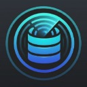
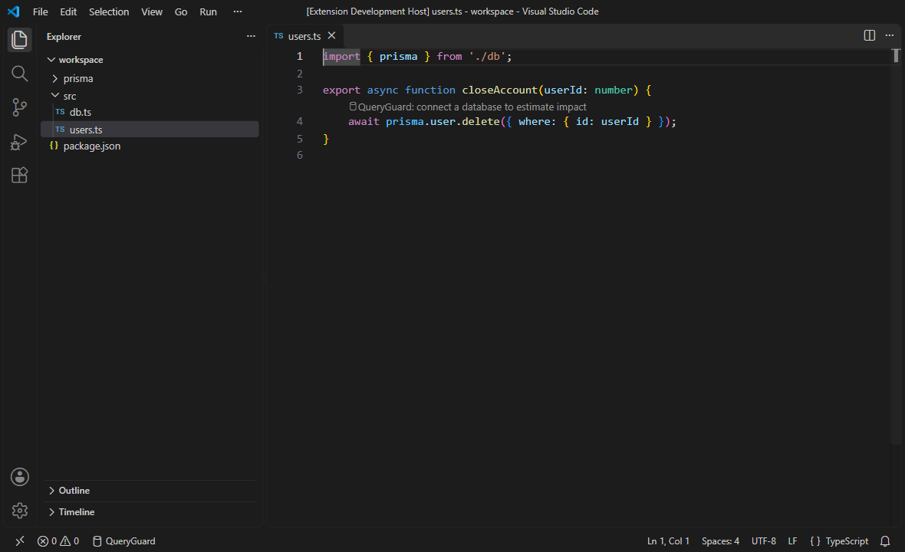
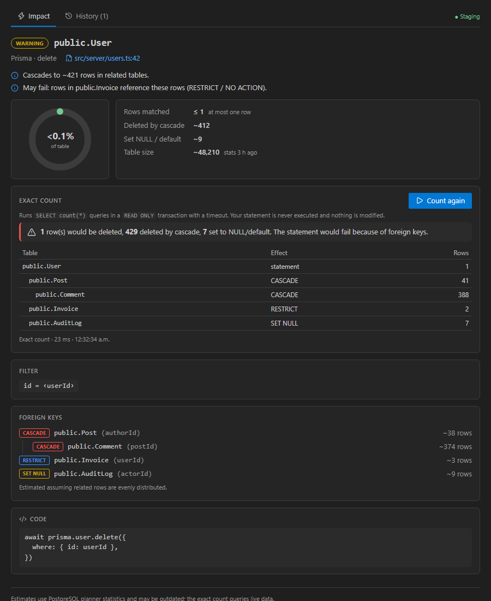

<p align="center">
  
</p>

<h1 align="center">QueryGuard</h1>

<p align="center">
  <b>Know how many rows a <code>delete</code> or <code>update</code> will touch — cascades included — before you run it.</b><br/>
  Prisma · Drizzle · Supabase · raw SQL — PostgreSQL
</p>

<p align="center">
  <a href="https://marketplace.visualstudio.com/items?itemName=queryguard.db-predictor"></a>
  <a href="https://open-vsx.org/extension/queryguard/db-predictor"></a>
  <a href="https://github.com/GabrielAv0301/DBPredictor/actions/workflows/ci.yml"></a>
</p>

[English](#english) · [Español](#español)



---

## English

QueryGuard reads your code as you type and flags database mutations that are more dangerous than they look:

```ts
await prisma.user.deleteMany(); // 🔥 DESTRUCTIVE — no filter, every row
await db.delete(users).where(eq(users.id, id)); // ⚠ 1 row + ~420 rows deleted by ON DELETE CASCADE
await supabase.from('logs').delete().lt('at', cutoff); // up to ~2.1M rows — run an exact count
```

### What it does

|                                                                                                  | Without a database | Connected to PostgreSQL |
| ------------------------------------------------------------------------------------------------ | ------------------ | ----------------------- |
| Detects `delete` / `update` / `deleteMany` / `updateMany` / raw `DELETE` · `UPDATE` · `TRUNCATE` | ✅                 | ✅                      |
| Warns about mutations **without a filter** (problem + CodeLens)                                  | ✅                 | ✅                      |
| Estimates affected rows from planner statistics                                                  | —                  | ✅                      |
| Follows foreign keys: `CASCADE`, `SET NULL`, `RESTRICT` / `NO ACTION`                            | —                  | ✅                      |
| **Exact count** of affected rows (read-only, see below)                                          | —                  | ✅                      |

### How the exact count works (and why it is safe)

Click **Count exactly** on a CodeLens (or run _QueryGuard: Count Affected Rows_). QueryGuard **never runs your statement**. It translates the filter into `SELECT count(*)` queries — one for the rows the statement matches and one per foreign-key path — and executes them:

- inside `BEGIN TRANSACTION READ ONLY` (PostgreSQL itself rejects any write) that is always rolled back,
- with a server-side `statement_timeout` (default 15 s) and `lock_timeout`,
- with every value sent as a bind parameter and every identifier taken from the database catalog and quoted.

If a filter value is only known at runtime (`where: { id: userId }`), QueryGuard asks you for a test value or counts without that condition and labels the result as an **upper bound**.



> Version 1.x simulated by running the real `DELETE` inside a rolled-back transaction. That takes row locks on production tables and fires triggers. 2.0 replaced it with the read-only approach above.

### Getting started

1. Open a TypeScript/JavaScript project. Unfiltered mutations are flagged immediately.
2. Run **QueryGuard: Connect to Database…** (or click _QueryGuard_ in the status bar) and paste a `postgresql://` URL. It is stored in the OS keychain through VS Code SecretStorage — never in settings or plain-text state.
3. CodeLenses now show row estimates. Click one for the impact panel, or **Count exactly** for live numbers.

The connection is remembered **per workspace**, so opening another project never connects to the wrong database. A profile whose name contains _prod_ turns the status bar item yellow.

### Supported code

| ORM          | Detected                                                                                                                                    | Filters translated for counting                                                       |
| ------------ | ------------------------------------------------------------------------------------------------------------------------------------------- | ------------------------------------------------------------------------------------- |
| **Prisma**   | `x.model.delete/update/deleteMany/updateMany` for `prisma`, `db`, `tx`, `this.prisma`… (configurable); `$executeRaw`, `$queryRaw` (+Unsafe) | equality, `null`, `in`, `lt/lte/gt/gte`, `not`, `contains/startsWith/endsWith`, `AND` |
| **Drizzle**  | `db.delete(t)`, `db.update(t).set()`, `db.execute(sql\`…\`)`                                                                                | `eq`, `ne`, `lt/lte/gt/gte`, `inArray`, `isNull`, `isNotNull`, `like/ilike`, `and`    |
| **Supabase** | `.from('t').delete()` / `.update()`, `.schema('s')`                                                                                         | `eq`, `neq`, `lt/lte/gt/gte`, `in`, `is`, `like/ilike`, `match`, `not(…,'is',null)`   |

Other conditions (`OR`, relation filters, `sql\`\``…) still count as "filtered" — they never trigger a false _DESTRUCTIVE_ — but the count is reported as an upper bound.

Table and column names are resolved like your ORM does: `@@map` / `@map` from `schema.prisma`, `pgTable('name', { col: integer('db_name') })` and `pgTableCreator` prefixes from Drizzle schemas, then naming conventions (`User` / `user` / `snake_case`) and the database `search_path`.

### Risk levels

| Level           | Meaning                                                                                |
| --------------- | -------------------------------------------------------------------------------------- |
| **DESTRUCTIVE** | Bulk mutation without a filter, or `TRUNCATE`. Every row is affected.                  |
| **CRITICAL**    | Estimated total (including cascades) above `queryguard.criticalRowThreshold` (10 000). |
| **WARNING**     | Filtered bulk mutation (upper bound), or a single-row delete that cascades.            |
| **SAFE**        | Single-row mutation without side effects.                                              |
| **UNKNOWN**     | Not connected, or the table was not found.                                             |

Silence one mutation with `// queryguard-ignore` on the line above (also available as a quick fix), or exclude files with `queryguard.exclude` (e.g. `**/*.test.ts`, `**/seed.ts`).

### Settings

| Setting                                                          | Default                  | Description                                                                                           |
| ---------------------------------------------------------------- | ------------------------ | ----------------------------------------------------------------------------------------------------- |
| `queryguard.enabled`                                             | `true`                   | Turn analysis on/off.                                                                                 |
| `queryguard.showCodeLens`                                        | `true`                   | Show CodeLenses.                                                                                      |
| `queryguard.diagnosticSeverity`                                  | `warning`                | `error`, `warning`, `information`, `hint` or `none` for DESTRUCTIVE/CRITICAL problems.                |
| `queryguard.criticalRowThreshold`                                | `10000`                  | Rows above which a mutation is CRITICAL.                                                              |
| `queryguard.exclude`                                             | `["**/node_modules/**"]` | Globs that are not analysed.                                                                          |
| `queryguard.prismaClientNames` / `queryguard.drizzleClientNames` | `prisma, db, tx…`        | Names of your client variables.                                                                       |
| `queryguard.autoConnect`                                         | `true`                   | Reconnect to this workspace's database on startup.                                                    |
| `queryguard.sslMode`                                             | `auto`                   | `auto`, `disable`, `require`, `verify-ca`, `verify-full` (machine-level only).                        |
| `queryguard.sslRootCertPath`                                     | —                        | PEM CA bundle (Supabase, RDS…) for `verify-ca` / `verify-full`.                                       |
| `queryguard.simulationTimeout`                                   | `15`                     | Seconds per count query, enforced by the server (max 120; whole simulation ≤ 4×; machine-level only). |
| `queryguard.cacheTTL`                                            | `300`                    | Schema/statistics refresh interval in seconds (0 = manual).                                           |
| `queryguard.analysisDebounce`                                    | `500`                    | Milliseconds to wait after typing.                                                                    |

`auto` TLS honours `sslmode` in the URL with **libpq semantics** (`require` = encrypted, not verified), uses no TLS for `localhost`, and `require` for remote hosts.

### Privacy & security

- No telemetry. QueryGuard only talks to the database you connect to.
- Credentials live in SecretStorage only; logs redact connection strings and passwords.
- The database role only needs `SELECT` on your tables (and access to the catalog). A read-only role is recommended.
- The webview runs with a strict Content-Security-Policy (no inline scripts or styles) and validates every message.

### Limitations

- PostgreSQL 11+ only (works with Supabase, Neon, RDS, Cloud SQL…).
- Estimates come from planner statistics (`n_live_tup`, `reltuples`) and assume related rows are evenly distributed; run the exact count for real numbers.
- Raw SQL is classified, not parsed: filters inside raw SQL are not translated, so its counts are upper bounds.
- Triggers and rules that delete or update other tables are not followed.
- Rows reachable through several foreign-key paths, or through self-referencing keys, make cascade totals approximate (shown with `~`).
- Counts run with the connected role: with row-level security (e.g. Supabase RLS) and a non-owner role they can be lower than what your application role would delete.

### Troubleshooting

- **"self-signed certificate in certificate chain"** — set `queryguard.sslRootCertPath` to your provider's CA file, or use `sslMode: require`.
- **"The server does not support SSL"** — set `queryguard.sslMode` to `disable` for that server.
- **"Table not found"** — check the schema in the status bar tooltip; Prisma `@@map` and Drizzle `pgTable` names are read from your project files.
- **Logs** — _QueryGuard: Show Logs_ (log level is configurable with _Developer: Set Log Level…_).

---

## Español

QueryGuard analiza tu código mientras escribes y marca las mutaciones de base de datos que son más peligrosas de lo que parecen: un `deleteMany()` sin filtro, un `delete` de un usuario que borra en cascada cientos de filas en otras tablas, o un `DELETE` que fallará por una clave foránea `RESTRICT`.

### Qué hace

- **Sin conexión:** detecta `delete` / `update` / `deleteMany` / `updateMany` de Prisma, Drizzle y Supabase, y `DELETE` / `UPDATE` / `TRUNCATE` en SQL crudo. Avisa de las mutaciones **sin filtro**.
- **Conectado a PostgreSQL:** estima las filas afectadas con las estadísticas del planificador, sigue las claves foráneas (`CASCADE`, `SET NULL`, `RESTRICT`/`NO ACTION`) y ofrece un **conteo exacto**.

### Conteo exacto seguro

QueryGuard **nunca ejecuta tu sentencia**. Traduce el filtro a consultas `SELECT count(*)` (una para las filas de la sentencia y una por cada camino de claves foráneas) y las ejecuta dentro de `BEGIN TRANSACTION READ ONLY` —PostgreSQL rechaza cualquier escritura—, con `statement_timeout` y `lock_timeout` en el servidor, valores como parámetros y nombres tomados del catálogo y entrecomillados. Si un valor solo se conoce en tiempo de ejecución (`where: { id: userId }`), te pide un valor de prueba o cuenta sin esa condición y lo marca como **cota superior**.

> La versión 1.x ejecutaba el `DELETE` real dentro de una transacción con `ROLLBACK`, lo que bloquea filas en producción y dispara triggers. La 2.0 lo sustituye por este enfoque de solo lectura.

### Primeros pasos

1. Abre un proyecto TypeScript/JavaScript: las mutaciones sin filtro se marcan al momento.
2. Ejecuta **QueryGuard: Connect to Database…** (o haz clic en _QueryGuard_ en la barra de estado) y pega una URL `postgresql://`. Se guarda en el llavero del sistema operativo mediante SecretStorage.
3. Los CodeLens muestran la estimación; haz clic para abrir el panel o en **Count exactly** para el conteo real.

La conexión se recuerda **por workspace**. Si el nombre del perfil contiene _prod_, el indicador de la barra de estado se pone amarillo.

Silencia una mutación con `// queryguard-ignore` en la línea anterior (también como _quick fix_) o excluye archivos con `queryguard.exclude`.

### Privacidad y limitaciones

- Sin telemetría. Las credenciales solo se guardan en SecretStorage y los logs ocultan contraseñas.
- Basta un rol con permisos `SELECT`; se recomienda un usuario de solo lectura.
- Solo PostgreSQL 11+. Las estimaciones usan estadísticas y suponen una distribución uniforme; el conteo exacto da el número real. El SQL crudo se clasifica pero sus filtros no se traducen. No se siguen triggers.

---

<p align="center">
  Made by <b>Gabriel Silva Avila</b> ·
  <a href="https://github.com/GabrielAv0301/DBPredictor">GitHub</a> ·
  <a href="https://mx.linkedin.com/in/gabriel-silva-avila-53b60b270">LinkedIn</a> ·
  MIT License
</p>
